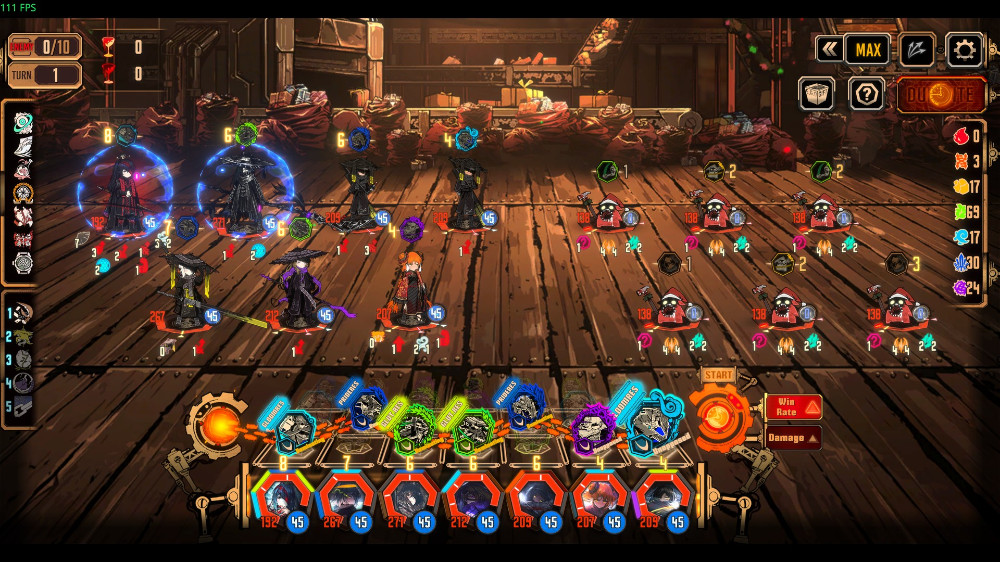

# HDR Screenshot

Capture any **screen**, **app window** or **region** in true HDR, or tone-map it to a clean SDR image that looks right everywhere.

Most screenshot tools capture 8-bit and clip everything brighter than SDR white, so HDR games and videos come out blown-out or washed-out. This app captures the desktop's real FP16 scRGB data through Windows.Graphics.Capture. It keeps the HDR values, and when you need an ordinary PNG/JPG it tone-maps them with a proper curve instead of clipping.



*Limbus Company, captured with **App** mode on an HDR monitor: 3840 × 2160, peak 993 nits, 7% of the frame brighter than SDR white (188 nits). Shown above tone-mapped with **Natural**. On an HDR display, open [the HDR PNG](docs/limbus-hdr.png) (1080p, BT.2020 PQ) in Chrome or Edge to see the real highlights.*

## Features

- **Three sources**
  - **Screen**: any monitor, at native resolution.
  - **App**: any window, even if it's covered by other windows. You get a searchable list with icons.
  - **Region**: the screen freezes, then you drag a box. Click a window to snap to it, Enter takes the whole screen, Esc cancels.
- **Real HDR output**
  - **JXR**: lossless FP16 scRGB, the same format Xbox Game Bar uses. Opens in HDR in Windows Photos.
  - **HDR PNG**: 16-bit BT.2020 PQ with `cICP` + `cLLi` chunks. Displays in HDR in Chrome, Edge and other HDR-aware viewers. Windows Photos doesn't read the `cICP` tag yet, so it shows these files grey and washed out. Use JXR for Photos.
- **SDR tone mapping** for PNG/JPG/clipboard
  - **Natural** (BT.2390 EETF): SDR content stays exactly as it looked, and highlights roll off smoothly. This is the default.
  - **Filmic** (Hable), **Reinhard**, or **Clip** (no tone mapping).
  - Exposure slider (±3 EV) and a live preview.
  - **Show HDR areas** stripes every pixel brighter than SDR white, so you can see what tone mapping affects.
- **HDR Viewer tab**: shows captures and HDR files in real HDR inside the app, without depending on Photos or Krita.
  - Opens JXR (including Game Bar captures), HDR PNG (PQ or HLG) and normal images. You can also drag a file onto the window.
  - **HDR / Tone-mapped / Split** views, with a draggable divider to compare the HDR original against the SDR export.
  - Scroll to zoom, drag to pan.
  - A file opened here becomes the current image, so you can re-export it from the Capture tab, for example to turn a Game Bar `.jxr` into a tone-mapped PNG.
- Reads each monitor's **SDR white level** and **peak brightness**, so SDR UI in the shot keeps its brightness.
- **Global hotkeys**: `Ctrl+Alt+S` region · `Ctrl+Alt+W` active window · `Ctrl+Alt+F` screen under the cursor.
- Optional **auto-save** and **copy to clipboard**. A small toast confirms hotkey captures without stealing focus from your game.
- Capture delay, cursor on/off, and hides itself while capturing.

## Requirements

- Windows 10 2004 or newer. Windows 11 is recommended because it removes the yellow capture border.
- For HDR capture, turn on "Use HDR" in Settings → Display. On an SDR monitor the app still works; HDR exports are then anchored at 203-nit reference white.

## Build

Needs the [.NET 8 SDK](https://dotnet.microsoft.com/download/dotnet/8.0).

```powershell
.\build.ps1                  # dist\HDRScreenshot.exe (needs .NET 8 Desktop Runtime)
.\build.ps1 -SelfContained   # dist\HDRScreenshot.exe with the runtime bundled
```

Or run from source: `dotnet run --project src\HdrScreenshot`.

## How it works

| Step | Where |
|---|---|
| Frames are captured as `R16G16B16A16_FLOAT` via `GraphicsCaptureItem` (monitor or HWND) and read back through a D3D11 staging texture | [Capture/CaptureEngine.cs](src/HdrScreenshot/Capture/CaptureEngine.cs) |
| SDR white level and HDR state come from `DisplayConfigGetDeviceInfo`; peak luminance comes from `IDXGIOutput6` | [Capture/Displays.cs](src/HdrScreenshot/Capture/Displays.cs) |
| Stats (robust 99.99th-percentile peak) and tone mapping run in parallel on the FP16 data | [Imaging/ToneMapper.cs](src/HdrScreenshot/Imaging/ToneMapper.cs) |
| JXR goes through WIC; HDR PNG uses a small built-in PNG writer | [Imaging/Exporters.cs](src/HdrScreenshot/Imaging/Exporters.cs) |
| The HDR viewer hosts a Win32 child window with an FP16 scRGB swap chain drawn by Direct2D, so DWM composites it in HDR | [UI/HdrView.cs](src/HdrScreenshot/UI/HdrView.cs), [Imaging/ImageLoader.cs](src/HdrScreenshot/Imaging/ImageLoader.cs) |

In scRGB, 1.0 = 80 nits. A pixel is "HDR" when it's brighter than the monitor's SDR white (`SDRWhiteLevel / 1000 × 80` nits).

Settings are stored in `%APPDATA%\HDRScreenshot\settings.json`. The UI shares its palette with [Pixelizer](https://github.com/The1Azreen/pixelizer) and [60fps GIF Maker](https://github.com/The1Azreen/60fpsgif). The icon is generated by `tools/make_icon.py`.
